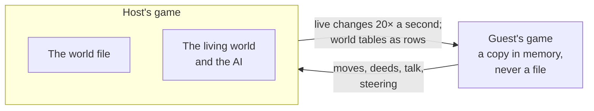

# Playing together

**One person hosts a world and friends join it.** Everyone walks the same world,
talks to the same people, and sees what the others make as it appears. Friends don't
need an AI key: the host's is used, up to a limit the host sets. Everyone needs a version of the game
that sends the same messages: any two builds whose messages and world tables match can
play, so a host on a tweaked dev build can have guests on the latest release.

| | Host | Friend |
|---|---|---|
| Needs | a world, and an AI key to make things and talk | a matching version of the game |
| Starts with | **Esc → Open to friends** | **Play together** on the title screen |
| Over the internet | ngrok, installed once | nothing extra |

---

## Same Wi-Fi

**Host**

1. In your world, press `Esc` and click **Open to friends**.

   

2. Click **On this network**.

   

3. Tell your friends the code shown on the next page.

**Friend**

1. On the title screen, click **Play together**.
2. Pick the host's game, click **Join**, and type the code.

If it doesn't work:

- **The game isn't listed**: some networks keep games from seeing each other. Click
  **Join with an invite…** and type the address the host was shown, and the code.
- **"macOS may be keeping this game off the local network"**: allow it in System
  Settings → Privacy & Security → Local Network (it may be listed as your terminal).
- **"didn't answer"**: if the host's Mac has its firewall on, the host allows Infinite
  Pocket in System Settings → Network → Firewall.

## Over the internet (ngrok)

**Host**

1. Install ngrok and sign in once. Your token is on [dashboard.ngrok.com](https://dashboard.ngrok.com).

   ```bash
   brew install ngrok
   ```

   ```bash
   ngrok config add-authtoken YOUR_TOKEN
   ```

2. In your world, press `Esc`, click **Open to friends**, then **For anyone (ngrok)**.

   

3. Click **Copy invite** and send it to your friends.

**Friend**

1. On the title screen, click **Play together**, then **Join with an invite…**

   

2. Click **Paste invite**, then **Join**.

   

---

## While playing

| | |
|---|---|
| `/say TEXT` | heard by everyone playing, and out loud by the people near you |
| `/invite` or `F5` | copy the address and code again |
| `/name NAME` | your name when playing together (from the next game) |
| `/kick NAME` | (host) send a guest away; they can't come back until the host hosts again |
| Settings → Together | your name, and (host) the most each guest may spend a session |

- **Everyone sees the same world**: the same log and journal, the same people with the
  same memories. A line about a player says "you" to that player and their name to
  everyone else.
- **Making things.** A guest's deeds and creations are done in the host's world and
  count as theirs on the Creations page. Their AI calls count against what that guest
  may spend. Only the host can `/undo`.
- **Riding and driving** work for guests too: their keys steer, and the host moves
  the vehicle or mount.

From the command line:

```bash
pocket host [FILE] [--port 7777] [--code CODE] [--ngrok]   # host a world (or your last)
pocket join ADDRESS CODE                                     # 192.168.1.20:7777, or an ngrok https URL
```

---

## How it works



- The host's game runs the world. Each guest's game keeps a copy in memory, made from
  the world's tables (types, places, regions, people, species, shaped ground) sent as
  rows, and kept live by changes 20 times a second (things, beings, fire, weather,
  their own wounds).
- A guest moves themselves and the host keeps it (a jump over 25 m is put back).
- When a guest joins, both sides compare what they send and keep: a hash of
  `src/net/wire.rs`, `src/net/rows.rs` and the world's schema, with `PROTOCOL` (bump it
  when a message's meaning changes but not its shape). If they match, release and commit
  may differ and both are told so; if not, the one who is behind is told to update.
- A guest whose connection is slower than what is sent skips the steady updates
  (bodies, the world near them, sounds) until it catches up.
- Code: `src/net` (wire, host, guest, discovery, ngrok), `src/app/together.rs`,
  `src/sim/travelers.rs` (other players as bodies), `src/sim/mirror.rs` (the world as
  a guest sees it). The design is in [multiplayer-plan.md](multiplayer-plan.md).

---

## Not done

- Guests earn no achievements (they are checked from what happens, which only the
  host's game has).
- The ngrok tunnel is tested against its log format, not live.
